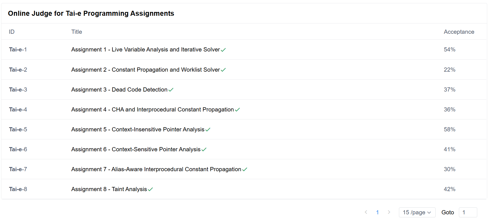

<div align="center">
  <a href="https://tai-e.pascal-lab.net/">
    
  </a>

  <h1>Tai-e Assignments</h1>
  <p>南京大学《静态分析》课程实验作业</p>

  <p>
    <a href="https://tai-e.pascal-lab.net/">Tai-e 官网</a> ·
    <a href="https://tai-e.pascal-lab.net/lectures.html">课程资料</a> ·
    <a href="https://tai-e.pascal-lab.net/intro/overview.html">实验说明</a>
  </p>
</div>

我的 Tai-e 课程实验代码，基于 [官方作业仓库](https://github.com/pascal-lab/Tai-e-assignments)。

A1–A8 已全部完成，OJ 全部 Accepted。课程实验到这里就做完了。



## 实验内容

| 作业 | 内容 | OJ |
| --- | --- | --- |
| [A1](A1/tai-e) | 活跃变量分析与迭代求解器 | Accepted |
| [A2](A2/tai-e) | 常量传播与 Worklist 求解器 | Accepted |
| [A3](A3/tai-e) | 死代码检测 | Accepted |
| [A4](A4/tai-e) | 类层次分析（CHA）与过程间常量传播 | Accepted |
| [A5](A5/tai-e) | 上下文不敏感指针分析 | Accepted |
| [A6](A6/tai-e) | 上下文敏感指针分析 | Accepted |
| [A7](A7/tai-e) | 别名感知的过程间常量传播 | Accepted |
| [A8](A8/tai-e) | 污点分析 | Accepted |

A8 在上下文敏感指针分析的基础上处理 source、sink 和污点传播，是这套实验的最后一部分。

## 本地运行

需要 JDK 17，Gradle 7.4 由项目自带的 Wrapper 下载，不用另装。

每个 `A*/tai-e` 都是独立的 Gradle 项目。以 A8 为例，运行本地测试：

```powershell
# Windows
cd A8/tai-e
.\gradlew.bat test
```

```bash
# macOS / Linux
cd A8/tai-e
./gradlew test
```

运行前需要有根目录 `lib/` 下的公共运行库，以及各实验 `lib/tai-e-assignment.jar`。如果使用了按需对象克隆，记得把这些 JAR 检出。

各实验的 `src/main/java` 是分析实现，`src/test` 是测试用例和期望结果，`plan.yml` 是分析配置。

## 许可证

Tai-e 相关代码遵循 [GNU LGPL v3](COPYING.LESSER)，详见 [COPYING](COPYING) 和 [COPYING.LESSER](COPYING.LESSER)。
